<p align="center">
  <picture>
    <source media="(prefers-color-scheme: dark)" srcset="assets/logo-dark.svg">
    
  </picture>
</p>

<p align="center"><b>How much did quantization rot your LLM?</b></p>

`bitrot` runs the same text through a full-precision LLM and its quantized versions (GGUF via llama.cpp, MLX on Apple Silicon), compares the probability distributions **token by token**, and tells you which quant to download for *your* prompts and *your* machine. Everything runs locally: no API keys, no cloud, no telemetry.

<p align="center">
  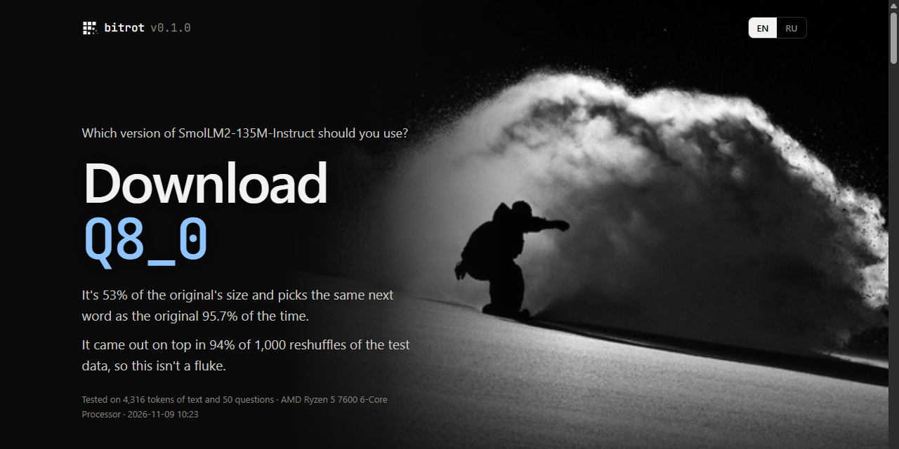
</p>

## What a run finds

A real run: SmolLM2-135M in F16 against its Q8_0, Q4_K_M and Q2_K quants, 10 prompts in 5 kinds of text and 50 test questions, on a Ryzen 5 7600. Every chart below is drawn from that run's `results.json`.

<p align="center">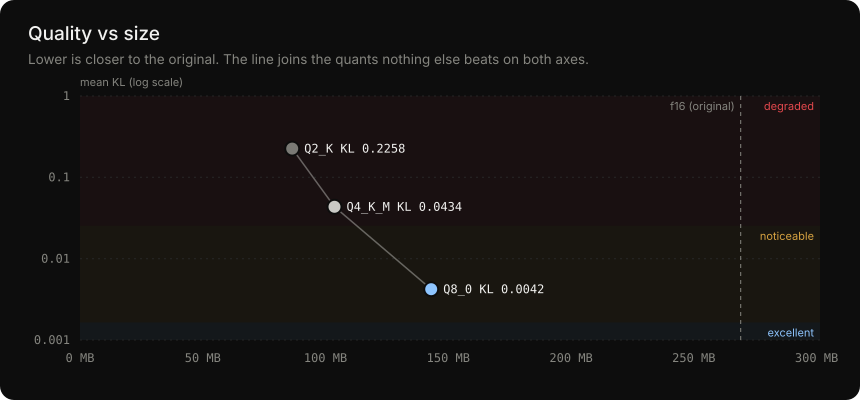</p>

**Smaller is worse, but not evenly.** Q8_0 halves the size for a 10× smaller drift than Q4_K_M. The shaded bands are the quality tiers, and they aren't hard-coded: they are fitted to how often this model's answers actually changed (see the calibration chart below).

<p align="center">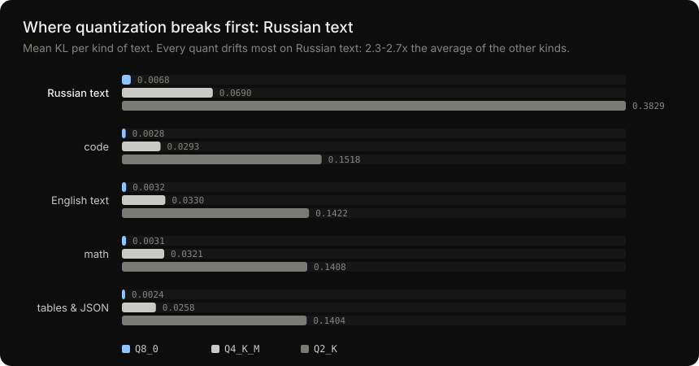</p>

**Quantization does not hurt every kind of text equally.** Every quant drifts most on Russian text. If you use a model mostly in one language or for code, measure on that.

<p align="center">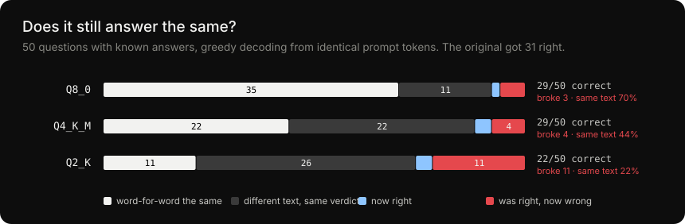</p>

**Drift turns into wrong answers.** By KL, Q8_0 looks almost lossless, yet 3 of the questions the original got right come out wrong. Q2_K breaks 11.

<p align="center">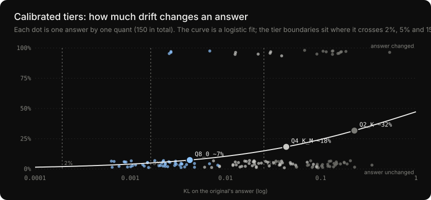</p>

**What counts as "fine" is fitted, not guessed.** Each dot is one answer by one quant. A logistic fit of "did the answer change" against KL gives the tier boundaries for this model. Small models are fragile: even Q8_0's KL of 0.004 means about 7% changed answers (8% were observed).

<p align="center">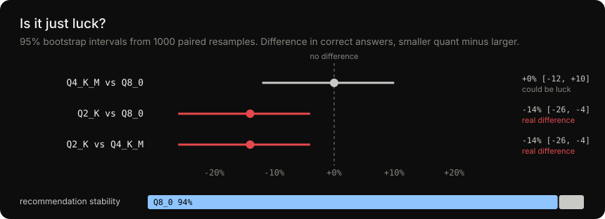</p>

**And it tells you when a difference is noise.** Q4_K_M drifts measurably more than Q8_0, but on 50 questions its answers are not distinguishably worse: the interval crosses zero. Q2_K is worse for certain. The recommendation survives 94% of 1,000 resamples of the data.

<details>
<summary>The same run in the terminal</summary>

```
$ bitrot compare SmolLM2-135M-f16.gguf SmolLM2-135M-Q8_0.gguf SmolLM2-135M-Q4_K_M.gguf SmolLM2-135M-Q2_K.gguf --open

  model                 size  of ref   KL mean    KL p99    top-1     ΔPPL decode t/s  quality
  F16                 269 MB    100%         0         0     100%        0       79.4  reference
  Q8_0 ◆              143 MB     53%    0.0042     0.032    95.7%   +0.46%      119.3  noticeable
  Q4_K_M ◆            104 MB     39%    0.0434     0.372    88.3%   +3.98%      120.4  degraded
  Q2_K ◆               86 MB     32%    0.2258     1.754    74.1%  +20.68%      155.3  degraded
  ◆ = Pareto-optimal (nothing else is both smaller and closer to the reference)

  answers on 50 tasks (greedy, up to 64 tokens)
  model              correct   broken   fixed   identical    differs after
  F16                  31/50        -       -           -                -
  Q8_0                 29/50        3       1         70%        ~7 tokens
  Q4_K_M               29/50        4       2         44%        ~6 tokens
  Q2_K                 22/50       11       2         22%        ~3 tokens
  broken = the original answered correctly, this quant did not

  calibrated tiers on 150 answers (answer verdict changed):
    2% change at KL 0.0002 · 5% change at KL 0.0016 · 15% change at KL 0.0253
  Q8_0             KL 0.0042 → ~7% of answers expected to change
  Q4_K_M           KL 0.0434 → ~18% of answers expected to change
  Q2_K             KL 0.2258 → ~32% of answers expected to change

  how sure are we? (95% bootstrap intervals, 1000 resamples, 32-token blocks)
  Q4_K_M vs Q8_0         KL +0.0392 [+0.0354, +0.0425] real difference · correct +0% [-12, +10] could be noise
  Q2_K vs Q8_0           KL +0.2216 [+0.1988, +0.2435] real difference · correct -14% [-26, -4] real difference
  Q2_K vs Q4_K_M         KL +0.1824 [+0.1618, +0.2011] real difference · correct -14% [-26, -4] real difference
  recommendation stability: Q8_0 94% · Q4_K_M 6%

  Q8_0 drifts most on russian (KL 0.0068)
  Q4_K_M drifts most on russian (KL 0.0690)
  Q2_K drifts most on russian (KL 0.3829)

  → use Q8_0  (no candidate is excellent; this is the smallest with mean KL < 0.0253,
               breaking at most 10% of the answers the original gets right)
```

</details>

## Why

"Q4_K_M or 4-bit MLX?" gets asked constantly, and the answers are blog posts with contradictory numbers. Perplexity hides most of the damage: two models can have the same perplexity and still disagree on which token comes next. llama.cpp can measure KL divergence, but only GGUF against GGUF, on its own text, without telling you *where* a quant breaks.

bitrot answers the questions that matter before you pick a quant:

- **How far does it drift?** Mean, p99 and max KL divergence from the reference, per token.
- **Does it still say the same thing?** Top-1 agreement, plus *confident flips*: positions where the original was more than 50% sure and the quant picked something else anyway.
- **Does it still give the same answers?** Every model answers questions with known solutions (arithmetic, facts, code, Russian) from the exact same prompt tokens. bitrot counts answers the quant **broke** (the original was right, the quant is wrong), how many outputs are token-for-token identical, and how many tokens in the text starts to differ. Distribution metrics alone can't show this: in the run above Q8_0 is "near-lossless" by KL, yet it still broke 3 of the 31 answers the original got right.
- **What counts as "fine" for *this* model?** Instead of fixed thresholds, bitrot fits a logistic curve P(answer changes | KL) on every answer it observed and puts the tier boundaries where 2%, 5% and 15% of answers are expected to change. Small models are fragile: for SmolLM2-135M even Q8_0's tiny KL of 0.004 is predicted to change ~7% of answers (8% were observed), so its tiers come out much stricter than generic rules of thumb.
- **Is the difference real or noise?** Every number gets a 95% bootstrap interval, every pair of quants gets a paired test, and the whole recommendation is re-run on 1000 resamples. Above: Q4_K_M drifts measurably more than Q8_0, but on 50 tasks its answers are *not* distinguishably worse. Q2_K's are, and the Q8_0 pick holds in 94% of resamples.
- **Where does it break first?** Breakdown by content type. In the run above every quant degrades about twice as fast on Russian text as on English or code, which is the kind of thing you only learn by measuring.
- **What does it cost to run?** Prefill and decode speed, memory, and on Apple Silicon **energy per token** read from the SoC's own counters.
- **Which one should I use?** The smallest quant that stays within your quality bar, plus the Pareto frontier of size vs. quality.

## The report

`--open` writes a single self-contained `report.html` (no CDN, works offline, English and Russian with a switch). It is written for people who have never heard of KL divergence: it opens with the answer ("Download Q8_0"), explains in plain words what was measured, and keeps the technical detail in a collapsible section at the end.

- **Your options**: one card per version with a plain verdict ("barely changed", "badly damaged"), its size, how often it picks the same next word, how many test answers it broke, and its speed.

- **Summary table** with quality tiers and the recommendation.
- **Quality vs. size** scatter with the Pareto frontier.
- **KL distribution** (CDF) per quant, so you can tell "slightly worse everywhere" apart from "fine except for rare catastrophes".
- **By content type** bars: code, prose, math, other languages, structured data.
- **Answers on real tasks**: correct / broken / fixed / identical per quant, and every changed answer side by side with the original's, with the point where the text diverges highlighted (e.g. `150 + 275 = 4`**`05`**).
- **How sure are we?**: intervals for every metric, "real difference / could be noise" for every pair of quants, and a bar showing how often each quant wins the recommendation across resamples.
- **Calibrated tiers**: every answer as a dot (KL vs. changed / unchanged), the fitted curve, the tier bands it implies, and where each quant lands on it.
- **Token explorer**: the actual text, each token tinted by how far the quant drifted there and underlined where the top token flipped. Hover any token to see the reference's top-5 next to the quant's top-5.
- **Biggest disagreements**: the worst positions with their context.

<p align="center">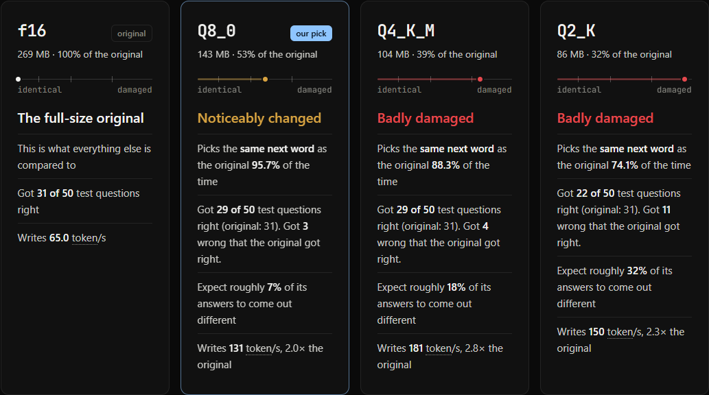</p>
<p align="center"><sub>One card per version, in plain words. The thin line under each name is its drift: from "identical" on the left to "damaged" on the right.</sub></p>

<p align="center">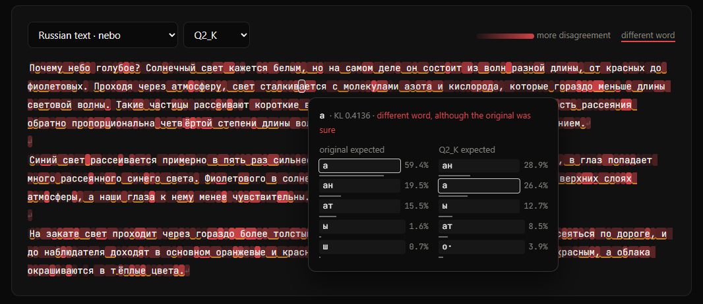</p>
<p align="center"><sub>The token explorer on Russian text with Q2_K. Shading is drift, underlines are changed words. Clicking a token compares the two models' top guesses: the original was 59% sure of «а», Q2_K preferred «ан».</sub></p>

<p align="center">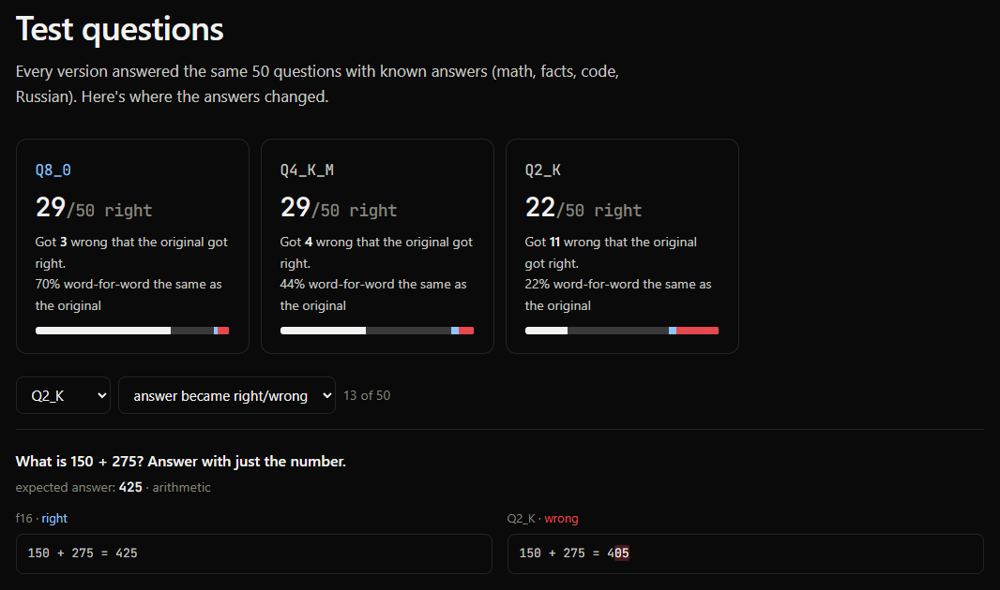</p>
<p align="center"><sub>Every answer that changed, next to the original's. The highlighted part is where the text first differs: <code>150 + 275 = 4</code><b>05</b>.</sub></p>

## Install

```bash
git clone https://github.com/Lyamon4/bitrot && cd bitrot
cargo install --path .                    # macOS: Metal is used automatically
cargo install --path . --features cuda    # Linux / Windows with an NVIDIA GPU
```

You need a Rust toolchain, CMake and a C/C++ compiler (llama.cpp is built from source). On Windows also set `LIBCLANG_PATH` (for example `pip install libclang`). For MLX models: `pip install mlx-lm`.

## Usage

### Terminal interface

Run `bitrot` with no arguments (or `bitrot tui --models <dir>`). It finds the GGUF files in `./models`, pre-selects the F16 file as the original and the rest as versions to compare, and runs everything with live progress. Then it shows the answer and four tabs: an overview with a drift line per version, where each version breaks first, the test answers that changed, and which conclusions survive the bootstrap.

<p align="center">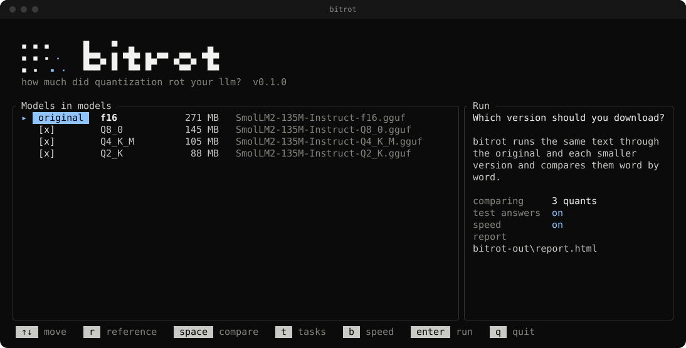</p>
<p align="center">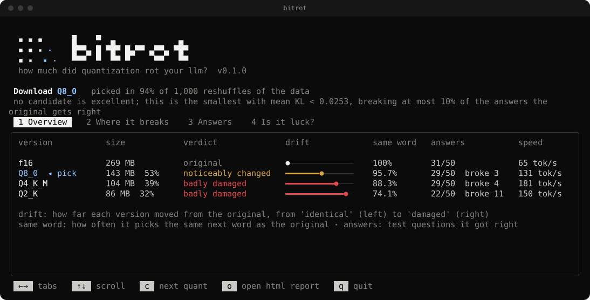</p>
<p align="center">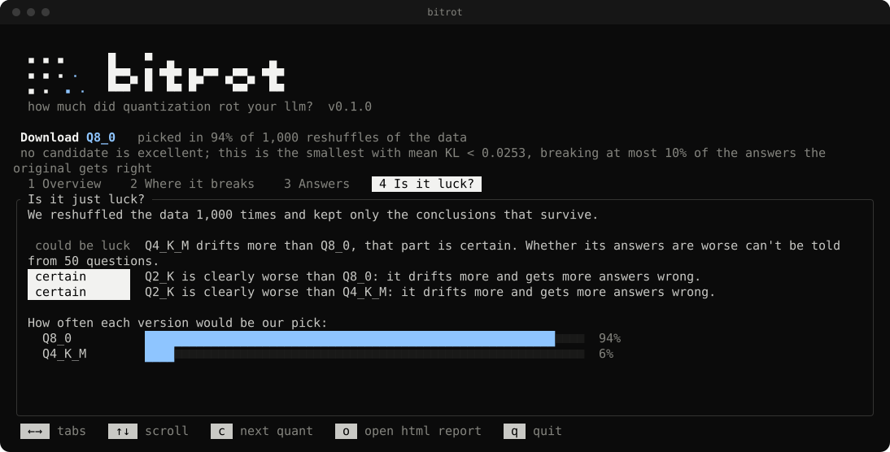</p>

Keys: arrows to move, `r` marks the original, space toggles a version, `t` and `b` switch the test answers and speed benchmark on or off, enter runs. On the results screen, left and right switch tabs, `c` cycles through versions, `o` opens the HTML report. `bitrot view bitrot-out/results.json` reopens a saved run.

### Command line

Quick comparison from the command line (GGUF paths, or `mlx:<dir or hf-repo>` for MLX):

```bash
bitrot compare model-f16.gguf model-Q8_0.gguf model-Q4_K_M.gguf --open
bitrot compare model-f16.gguf mlx:mlx-community/Qwen2.5-1.5B-Instruct-4bit model-Q4_K_M.gguf
```

Or describe the run in a config file (see [`examples/`](examples)):

```bash
bitrot run -c examples/smollm2.toml --open
bitrot run -c examples/gguf-vs-mlx.toml --open   # GGUF vs MLX on Apple Silicon
bitrot report bitrot-out/results.json --open    # re-render a saved run
```

Use your own prompts: put text files into `prompts/<category>/<name>.txt` and pass `--prompts`. The bundled set covers English prose, Russian prose, Rust and Python code, math, and JSON/tables/SQL/CSV.

Use your own tasks: add `.jsonl` files to `tasks/` (the file name becomes the category), one task per line:

```json
{"id": "mul-1", "prompt": "What is 6 times 7? Answer with just the number.", "answer": "42", "check": "number"}
{"id": "ru-cap", "prompt": "Какая столица Франции? Ответь одним словом.", "answer": "Париж", "accept": ["Paris"]}
```

`check` is `number` (last number in the output), `contains` (default: expected text near the start, case-insensitive) or `exact` (first line). Prompts are wrapped in the reference's chat template once, and the same token ids go to every model.

| flag | default | meaning |
|---|---|---|
| `--ctx` | 512 | tokens per evaluation window |
| `--top-k` | 64 | reference tokens kept per position for the KL estimate |
| `--max-tokens` | 1024 | cap per prompt file |
| `--threads` | physical cores | llama.cpp CPU threads |
| `--no-bench` | off | skip speed, memory and energy |
| `--tasks` | `tasks/` | directory with `.jsonl` tasks |
| `--gen-tokens` | 64 | max tokens generated per task |
| `--no-tasks` | off | skip the answer check |
| `--bootstrap` | 1000 | resamples for confidence intervals (0 = off) |
| `--python` | `python3` | interpreter with `mlx-lm`, for MLX models |

## How it works

<p align="center">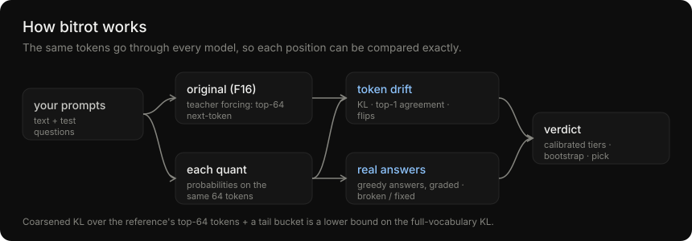</p>

1. **Teacher forcing.** Every prompt is tokenized once by the reference, and the *same token ids* go through every model, so positions line up exactly. bitrot refuses to compare models whose tokenizers disagree.
2. **Coarsened KL.** At each position the reference keeps its top-k tokens (k = 64). Each quant reports its probabilities for exactly those tokens, and the rest of the vocabulary is pooled into one tail bucket on both sides. The KL divergence of these (k+1)-bucket distributions is, by the data-processing inequality, a **lower bound** on the full-vocabulary KL. It is tight in practice because the reference tail is tiny, and it means models never have to ship 150k-wide logit rows between processes.
3. **Behaviour check.** Each model greedily answers the tasks, starting from identical prompt ids. Answers are graded automatically, compared with the reference's verdict (broken / fixed), and the first differing token is recorded. A quant is only recommended if it breaks at most 10% (configurable: `max_regression`) of the answers the original gets right.
4. **Calibration.** Every quant also scores the reference's own answers under teacher forcing, which gives one point per (quant, task): x = mean per-token KL on that answer, y = did the quant's own answer change (right↔wrong; if verdicts almost never flip, "the text changed" is used instead). A two-parameter logistic regression, logit P = a + b·ln KL, is fitted by Newton's method, and the tier boundaries become the KL values where P = 2%, 5% and 15%. Calibration is skipped, and the defaults below are used, when there are fewer than 5 changed or 5 unchanged answers, or when changes don't increase with KL.
5. **Uncertainty.** A paired bootstrap (1000 resamples, `--bootstrap N`, 0 = off). Prompt tokens are resampled in 32-token blocks because neighbouring tokens are correlated, and tasks are resampled individually. Each replicate evaluates every quant on the same resample (so differences are paired), re-fits the calibration, and re-runs the recommendation rule. The report shows percentile intervals, which pairwise differences exclude zero, and how often each quant would have been picked. Per-block sums are precomputed, so 1000 replicates take milliseconds.
6. **Backends.**
   - **llama.cpp**, in-process through [`llama-cpp-2`](https://crates.io/crates/llama-cpp-2): one batched decode per window with logits for every position, log-softmax and top-k in Rust.
   - **MLX**, through a small Python worker embedded in the binary that speaks JSON lines over stdin/stdout.
7. **Energy on Apple Silicon.** A small Objective-C module ([`objc/kld_mac.m`](objc/kld_mac.m)) subscribes to the `Energy Model` channels of IOReport, the same counters `powermetrics` reads, without needing root. It samples CPU, GPU, ANE and DRAM energy around the decode loop and subtracts an idle baseline measured at start-up. It also reads the process `phys_footprint` (which includes Metal buffers in unified memory) and the chip name.

```
src/
  main.rs        CLI (compare / run / report)
  runner.rs      pipeline: reference pass, candidate passes, benchmarks
  metrics.rs     coarsened KL, top-1 agreement, confident flips, summaries
  tasks.rs       task loading, answer grading, broken/fixed/divergence stats
  calibrate.rs   logistic fit of P(answer changes | KL) -> per-model tier thresholds
  stats.rs       paired block bootstrap: intervals, pairwise tests, recommendation stability
  recommend.rs   the recommendation rule as a pure function (re-run inside the bootstrap)
  dist.rs        log-softmax + top-k from raw logits
  backend/       llama.cpp (in-process) and MLX (worker) backends
  sys.rs         machine info, IOReport energy meter (FFI)
  report.rs      terminal table + HTML rendering
objc/kld_mac.m   IOReport, phys_footprint, sysctl (macOS only)
workers/         MLX worker (embedded with include_str!)
assets/          report template (vanilla JS + SVG, no dependencies)
```

## Reading the numbers

| tier | mean KL (nats) | what it usually means |
|---|---|---|
| near-lossless | < 0.01 | indistinguishable in practice |
| excellent | < 0.05 | rare small wording changes |
| noticeable | < 0.15 | visibly different outputs, reasoning may slip |
| degraded | ≥ 0.15 | frequent wrong tokens, especially off-English |

These are the **defaults**. When tasks are run (the default), they are replaced by thresholds calibrated on the model's own answers (see *How it works*), and the report shows the fitted curve. You can also set them by hand in the `[thresholds]` section of a config. Compare quants of the *same* model on the *same* prompts. Absolute KL values are not comparable across model families.

## Regenerating the pictures

The charts are drawn from a run's data and the TUI images are rendered by bitrot itself (ratatui's test backend, so they are the real interface):

```bash
python scripts/readme_charts.py bitrot-out/results.json assets/charts
bitrot view bitrot-out/results.json --svg assets/screens/tui-tab1.svg --shot 1   # setup, or tab 1-4
```

## Limitations

- KL is measured under teacher forcing (scoring known text), which makes it exact and reproducible. The task check covers free generation, but only for short answers. Small task sets are noisy: with 50 tasks one answer is 2 percentage points.
- Energy is package-wide (the whole SoC), not per process. Close heavy apps for clean numbers.
- IOReport is a private Apple interface. If a future macOS changes it, energy reporting switches off and everything else keeps working.

## License

MIT

The background photo in the report (`assets/hero.jpg`) is by the author, [@Lyamon4](https://github.com/Lyamon4).
